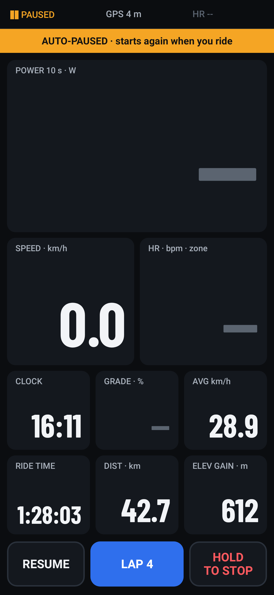
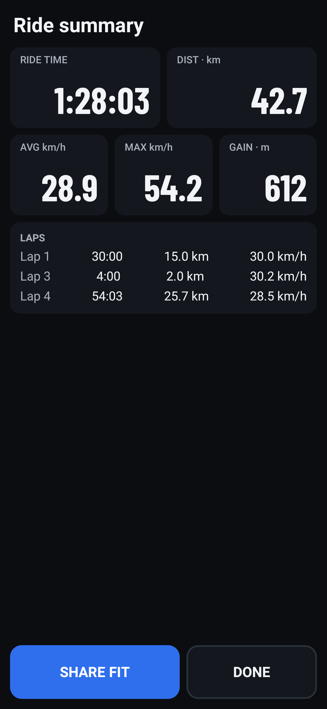

# Painmeter

Android bike computer computing **estimated live watts without a power meter**, from phone GPS,
offline elevation data, weather and your own CdA / Crr. See [SPEC.md](SPEC.md).

## Status

Phase 1 of 8: ride recording.

- Start / auto-pause / manual pause / stop, ride time, distance, speed, average speed, elevation
  gain (from GPS altitude for now; elevation tiles come in phase 3).
- Recording keeps running with the screen off (foreground service).
- **Lap**: volume-down key, or the LAP button.
- Crash-safe: every second is written to a journal; a ride left open is offered for resume.
- FIT export at the end of the ride (share to Strava, Drive, e-mail…).

Heart rate (phase 2) and power (phase 3) show `--` for now.

| Ride | Auto-pause | Summary |
|---|---|---|
|  |  |  |

## Install on the phone

Every push builds the app on GitHub Actions. Open the latest run of the **Build** workflow, download
the `painmeter-apk` artifact (a zip holding `app-debug.apk`), copy it to the phone and open it.
Android asks once to allow installs from that app.

The APK is signed with a fixed debug key kept in `keystore/`, so a new build installs over the
previous one without losing rides. That key is for personal use, not for publishing.

## Build locally

Needs JDK 17+ and the Android SDK (platform 35).

```bash
./gradlew :core:test :app:testDebugUnitTest   # logic tests + screen renders (app/build/outputs/roborazzi)
./gradlew :app:assembleDebug                  # app/build/outputs/apk/debug/app-debug.apk
```

## Layout

- `core/`: pure Kotlin, no Android: ride state machine, auto-pause, laps, elevation gain, journal,
  FIT export (Garmin FIT SDK). Later: the power model and the calibration.
- `app/`: Android app: `RideService` (foreground GPS), `RideController`, Compose screens in `ui/`.

## Licences

Code: Apache-2.0. Barlow Condensed font: SIL Open Font License (`licenses/`).
FIT files are written with the Garmin FIT SDK under the FIT Protocol License.
