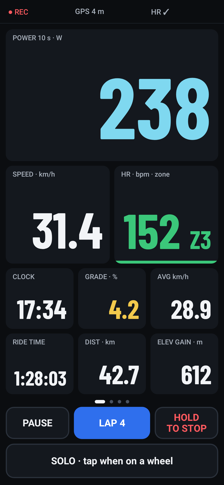
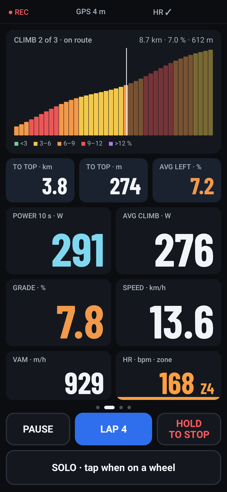
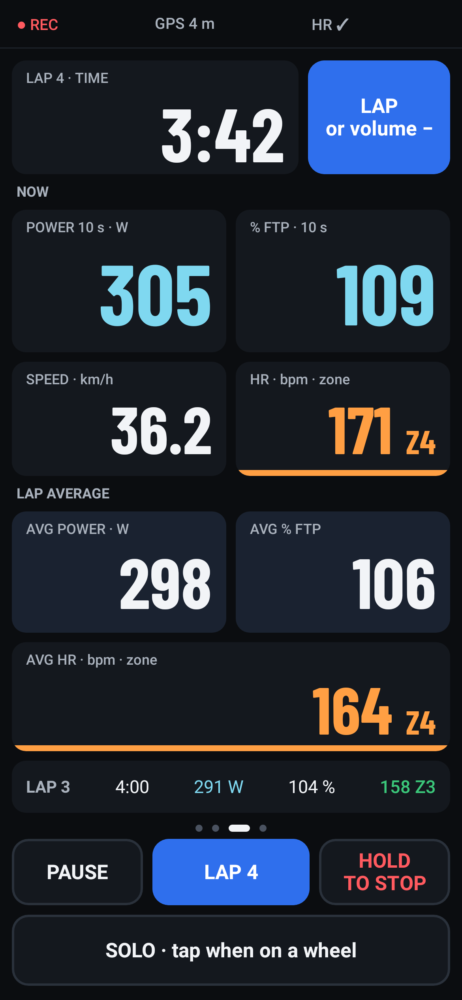
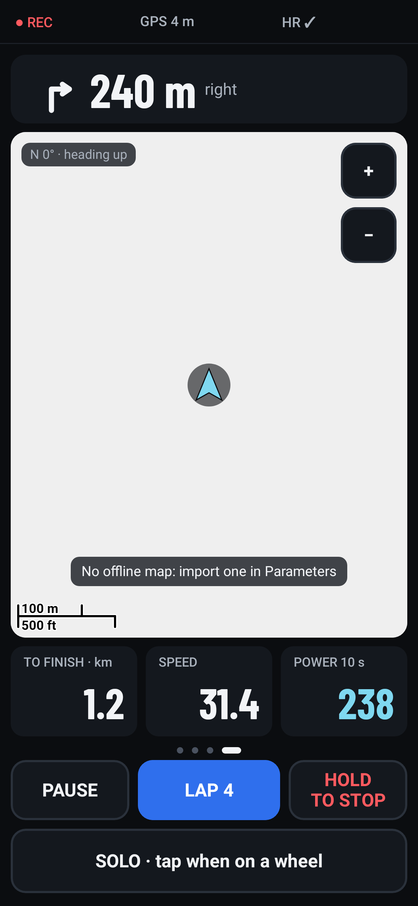
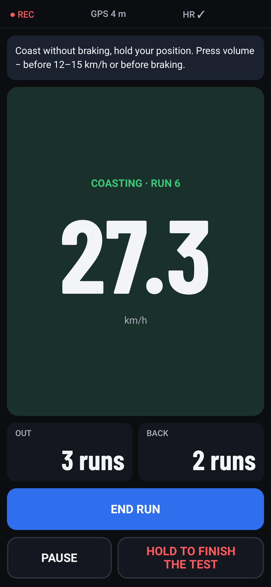
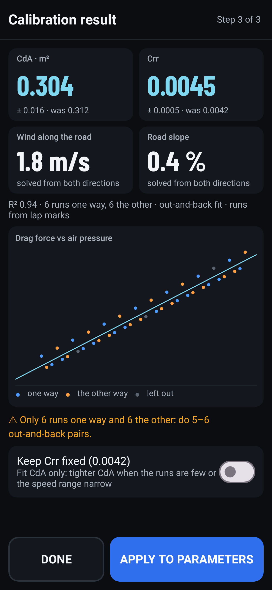
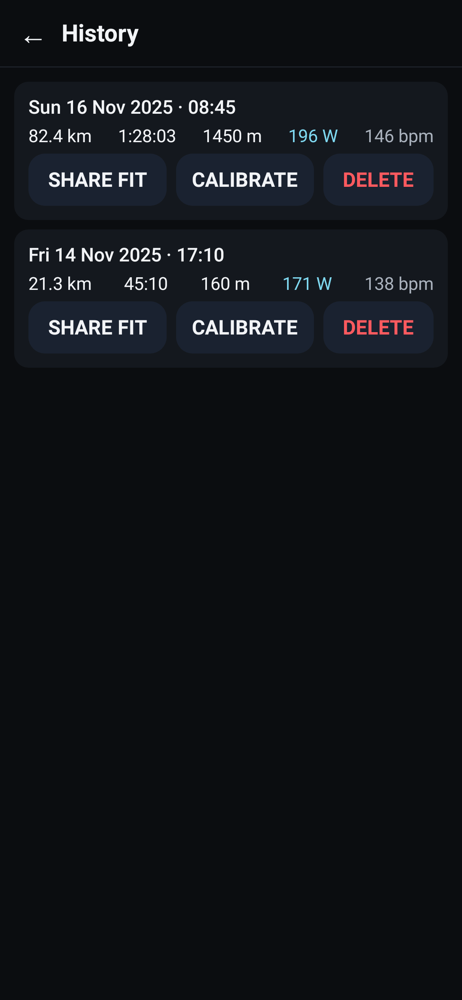
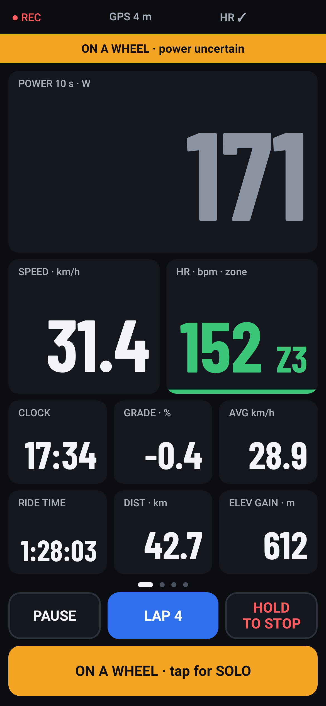
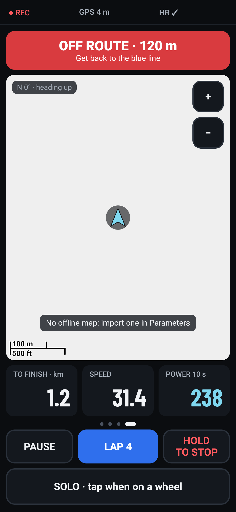

# Painmeter

Android bike computer computing **estimated live watts without a power meter**, from phone GPS,
offline elevation data, weather and your own CdA / Crr. See [SPEC.md](SPEC.md).

## Status

Phases 1–6 of 8: recording, heart rate, live estimated power, map and route, climbs, **laps, calibration and history**.

- **Power** (phase 3): your CdA, Crr and weights, offline elevation tiles for the gradient, live
  weather (wind at rider height, air density). 10 s power on the Data page, cyan when reliable,
  grey when less so (poor GPS, On a wheel, no elevation data, very slow). Average, NP and max power
  in the summary and per lap. Power, grade and Painmeter's own fields in the FIT file.
- **On a wheel** button: cuts CdA by the factor set in Parameters (0.65), amber banner, reminder
  after 20 min.
- The physics are a port of the [Power-calcualtor](https://github.com/Marvin-inc/Power-calcualtor)
  web tool, checked point by point against it (`core/src/test/.../PostRideModelTest`).
- Recording: start, auto-pause, pause, stop, laps (volume-down key), crash-safe journal with
  resume, FIT export.
- Heart rate: any Bluetooth LE strap, HR + zone field, zones, time in zones.
- **Map page** (phase 4, swipe left from the Data page): offline Mapsforge map, heading up, route
  in blue and ridden track in cyan, zoom kept between rides; with a GPX route: next-turn arrow from
  300 m (vibration at 100 m), distance to finish, OFF ROUTE alert after 10 s more than 50 m away.
  Import a GPX in Parameters or open one from Komoot / Strava / Files with Painmeter.
- **Climbs** (phase 5): found in advance on the route, or detected live (start moved back to where
  the gradient first went above 3 %). Climb page: profile coloured by gradient, power 10 s, average
  power since the start of the climb, gradient, speed, VAM, HR; on a route also distance, height
  and average gradient left to the top, and the next climb when not climbing. The page opens by
  itself when a climb starts. On a route the gradient comes from the route profile (no lag).
  Climbs table in the summary.
- **Lap page** (phase 6): lap time, power 10 s and %FTP, speed, HR; lap averages (power, %FTP,
  HR + zone); the last lap below.
- **Calibration** (phase 6): Parameters → Bike & aero → Calibrate. Guided coast-down test (volume −
  at the start and end of each coast, runs counted each way), then CdA ±, Crr ±, wind and slope
  solved from the out-and-back runs, R², the drag plot, warnings when weak, "Keep Crr fixed", and
  **Apply to parameters**. Also works on any past ride. Port of the web tool's calibration, checked
  against it (`CoastDownTest`).
- **History** (phase 6): past rides with distance, time, gain, power, HR; open the summary, share
  the FIT file, calibrate from a ride, delete.

Before the first ride, set in **Parameters**: weight, FTP, bike weight, CdA, Crr, max HR and zones,
then **Download around me** (elevation data, ≈ 100 MB, on Wi-Fi), and import your region's map
(**Get maps** → download the `.map` file → **Import .map**).

| Ride | Climb | Lap | Map | Summary |
|---|---|---|---|---|
|  |  |  |  |  |

| Calibration test | Calibration result | History | On a wheel | Off route |
|---|---|---|---|---|
|  |  |  |  |  |

## Install on the phone

Every push builds the app on GitHub Actions. Open the latest run of the **Build** workflow, download
the `painmeter-apk` artifact (a zip holding `app-debug.apk`), copy it to the phone and open it.
Android asks once to allow installs from that app.

The APK is signed with a fixed debug key kept in `keystore/`, so a new build installs over the
previous one without losing rides. That key is for personal use, not for publishing.

## Build locally

Needs JDK 17+ and the Android SDK (platform 35).

```bash
./gradlew :core:test :app:testDebugUnitTest   # logic tests + screen renders (app/build/outputs/roborazzi)
./gradlew :app:assembleDebug                  # app/build/outputs/apk/debug/app-debug.apk
```

## Layout

- `core/`: pure Kotlin, no Android: ride state machine, auto-pause, laps, elevation gain, journal,
  FIT export (Garmin FIT SDK), heart rate, the power model (`power/`), elevation tiles
  (`elevation/`), GPX routes, route following and turn detection (`route/`), climbs (`climb/`), coast-down calibration (`calibration/`).
- `tools/golden/`: regenerates the reference data from the web tool with Node (power model and
  calibration).
- `app/`: Android app: `RideService` (foreground GPS), `RideController`, Compose screens in `ui/`.

## Licences

Code: Apache-2.0. Barlow Condensed font: SIL Open Font License (`licenses/`).
FIT files are written with the Garmin FIT SDK under the FIT Protocol License.
Elevation data: AWS Terrain Tiles (SRTM and other sources, see their attribution).
Weather: Open-Meteo (CC BY 4.0).
Maps: Mapsforge (LGPL-3.0) with OpenStreetMap data (© OpenStreetMap contributors, ODbL).
