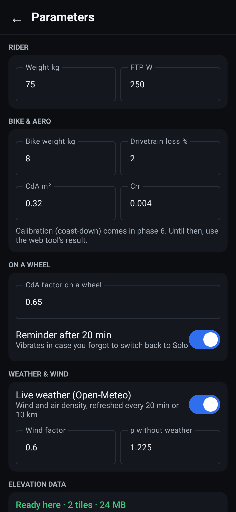

# Painmeter

Android bike computer computing **estimated live watts without a power meter**, from phone GPS,
offline elevation data, weather and your own CdA / Crr. See [SPEC.md](SPEC.md).

## Status

Phases 1–3 of 8: recording, heart rate, **live estimated power**.

- **Power** (phase 3): your CdA, Crr and weights, offline elevation tiles for the gradient, live
  weather (wind at rider height, air density). 10 s power on the Data page, cyan when reliable,
  grey when less so (poor GPS, On a wheel, no elevation data, very slow). Average, NP and max power
  in the summary and per lap. Power, grade and Painmeter's own fields in the FIT file.
- **On a wheel** button: cuts CdA by the factor set in Parameters (0.65), amber banner, reminder
  after 20 min.
- The physics are a port of the [Power-calcualtor](https://github.com/Marvin-inc/Power-calcualtor)
  web tool, checked point by point against it (`core/src/test/.../PostRideModelTest`).
- Recording: start, auto-pause, pause, stop, laps (volume-down key), crash-safe journal with
  resume, FIT export.
- Heart rate: any Bluetooth LE strap, HR + zone field, zones, time in zones.

Before the first ride, set in **Parameters**: weight, FTP, bike weight, CdA, Crr, max HR and zones,
then **Download around me** (elevation data, ≈ 100 MB, on Wi-Fi).

| Ride | On a wheel | Parameters | Summary |
|---|---|---|---|
|  |  |  |  |

## Install on the phone

Every push builds the app on GitHub Actions. Open the latest run of the **Build** workflow, download
the `painmeter-apk` artifact (a zip holding `app-debug.apk`), copy it to the phone and open it.
Android asks once to allow installs from that app.

The APK is signed with a fixed debug key kept in `keystore/`, so a new build installs over the
previous one without losing rides. That key is for personal use, not for publishing.

## Build locally

Needs JDK 17+ and the Android SDK (platform 35).

```bash
./gradlew :core:test :app:testDebugUnitTest   # logic tests + screen renders (app/build/outputs/roborazzi)
./gradlew :app:assembleDebug                  # app/build/outputs/apk/debug/app-debug.apk
```

## Layout

- `core/`: pure Kotlin, no Android: ride state machine, auto-pause, laps, elevation gain, journal,
  FIT export (Garmin FIT SDK), heart rate, the power model (`power/`), elevation tiles
  (`elevation/`). Later: the calibration.
- `tools/golden/`: regenerates the reference data from the web tool with Node.
- `app/`: Android app: `RideService` (foreground GPS), `RideController`, Compose screens in `ui/`.

## Licences

Code: Apache-2.0. Barlow Condensed font: SIL Open Font License (`licenses/`).
FIT files are written with the Garmin FIT SDK under the FIT Protocol License.
Elevation data: AWS Terrain Tiles (SRTM and other sources, see their attribution).
Weather: Open-Meteo (CC BY 4.0).
